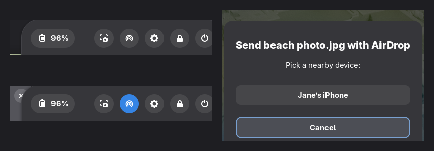

# AirDrop for GNOME

AirDrop between iPhones and a GNOME laptop, from where you'd expect it: a round button in
Quick Settings, Accept / Decline notifications, and **Send with AirDrop…** when you
right-click a file. Built on [Owly](https://github.com/t4t5/owly), which does the AirDrop
radio and protocol on Linux.

<p align="center"></p>

## What it does

- **On and off like Wi-Fi.** A round AirDrop button sits in Quick Settings' top row, next to
  the other system buttons, and lights up in your accent colour while AirDrop is on. A small
  icon shows in the top bar meanwhile.
- **Receive.** Nearby iPhones see your laptop (as "ThinkPad" by default). When one sends
  something, a notification asks **Accept / Decline**. Files land in Downloads with
  **Open / Show in Files**; links get **Open link**.
- **Send.** Right-click files in Files → **Send with AirDrop…**, pick the iPhone from the
  nearby devices, and get a notification when it's delivered or declined. The app grid's
  AirDrop icon has **Send Files…** too.
- **Wi-Fi always comes back.** See below.

## Wi-Fi

Owly runs in one of two modes depending on your Wi-Fi card ([supported cards](https://github.com/t4t5/owly#supported-hardware)).
On cards that can do *shared* mode, Wi-Fi stays connected. On **Intel cards** (and others
in *exclusive* mode) Wi-Fi pauses while AirDrop is on, so this extension keeps that as short
and safe as possible:

- AirDrop only turns on when you turn it on.
- After a transfer it **turns itself off** (15 seconds after the last file or link), and
  after sending it turns off right away.
- It **never stays on longer than 10 minutes.** The limit is enforced by Owly's own service,
  so Wi-Fi comes back even if GNOME Shell or a terminal goes away.
- After AirDrop stops, it checks that Wi-Fi reconnected, and asks NetworkManager to reconnect
  if it didn't.

A USB Wi-Fi adapter that Owly supports (for example MediaTek MT7612U) can run AirDrop as a
second card while the built-in one stays connected; see Owly's README.

## Install

Needs Fedora with GNOME Shell 50 (tested on Fedora 44) and a Wi-Fi card Owly supports
(check with `owly doctor` after installing).

```bash
git clone https://github.com/aimanelahssini/gnome-airdrop
cd gnome-airdrop
./install.sh
```

It asks for your password once to install Owly (newest release, checked against GitHub's
checksum), `zenity` and `nautilus-python`. Then log out and back in so GNOME loads the
extension.

On Fedora, Owly's service ships in `/usr/lib` with a library SELinux label, which runs it in
systemd's own confined context where it can't see the Wi-Fi card (`owly doctor` then says
*no Wi-Fi interface*). `install-owly.sh` relabels it as a normal program, so it runs as a
regular third-party service.

## Use it from the terminal

| Command | What it does |
|---|---|
| `airdrop` | Receive into Downloads until you stop it (Ctrl+C) |
| `airdrop send FILE…` | Send files to a nearby iPhone |
| `airdrop link URL` | Send a link |

The name iPhones see is in `~/.config/airdrop/name` (default `ThinkPad`).

## How it works

The extension runs `owly radio up --for 600` and `owly receive` in the background. Owly asks
*accept? [y/N]* on its terminal and declines by itself after 15 seconds; the extension reads
that question and answers it from the notification buttons. Sending uses `owly browse` for the
device list and `owly send`. Files and the app entry reach the extension over D-Bus
(`io.github.aimanelahssini.AirDrop`: `Toggle`, `SendFiles`, `ChooseAndSend`).

## Uninstall

```bash
gnome-extensions disable airdrop@aimanelahssini
rm -rf ~/.local/share/gnome-shell/extensions/airdrop@aimanelahssini
rm ~/.local/bin/airdrop ~/.local/share/applications/airdrop.desktop \
   ~/.local/share/nautilus-python/extensions/airdrop.py
sudo dnf remove owly
```

## Credits

[Owly](https://github.com/t4t5/owly) by t4t5 (MIT) does the AirDrop part. This project is
the GNOME front end. Not affiliated with Apple; AirDrop is a trademark of Apple Inc.

## License

MIT
